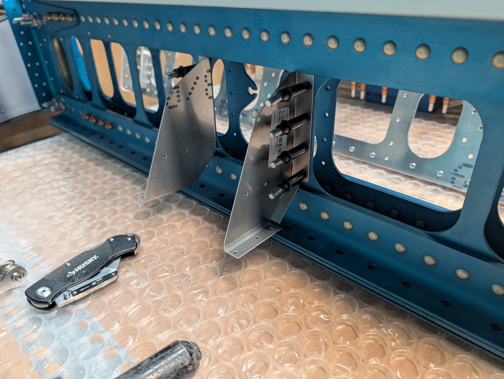
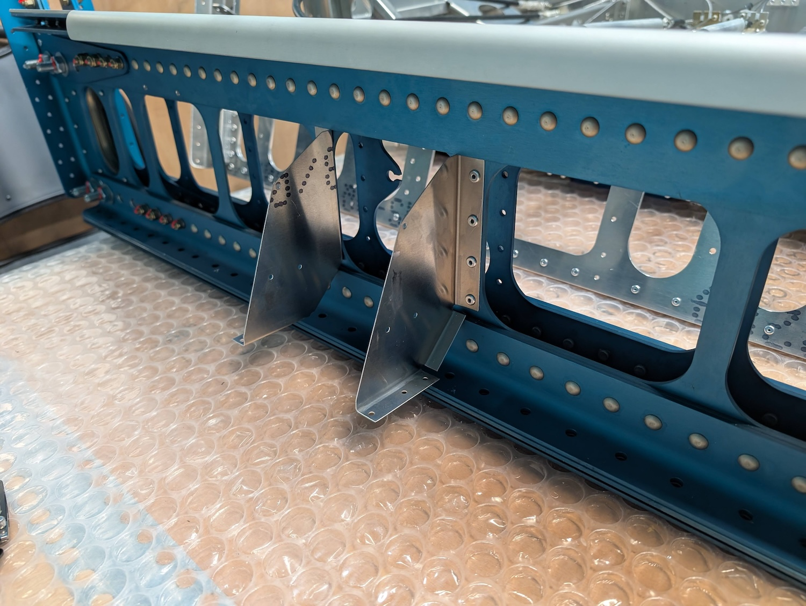
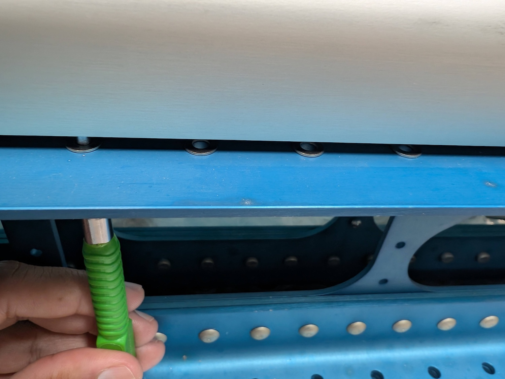
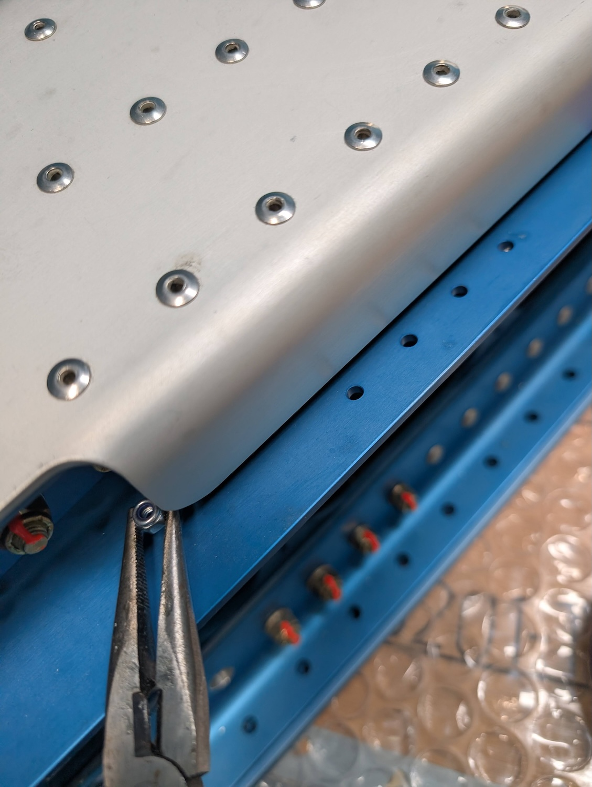
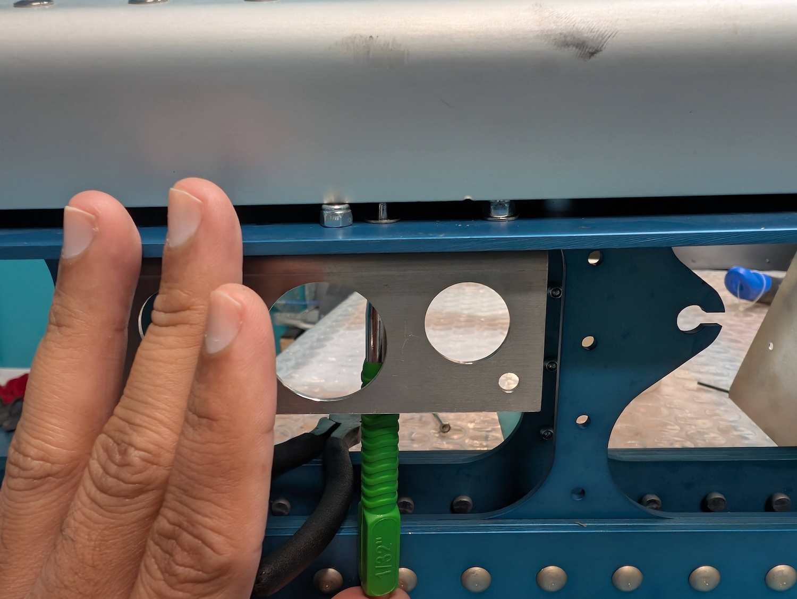
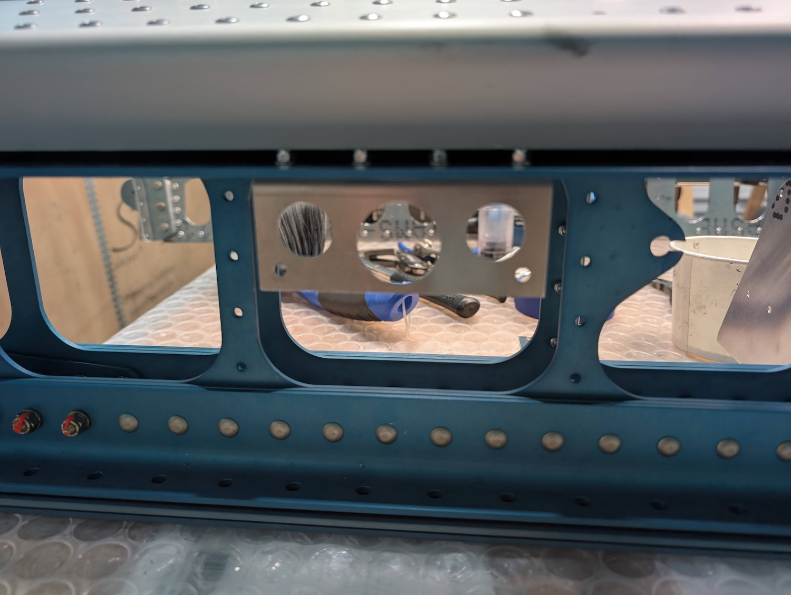
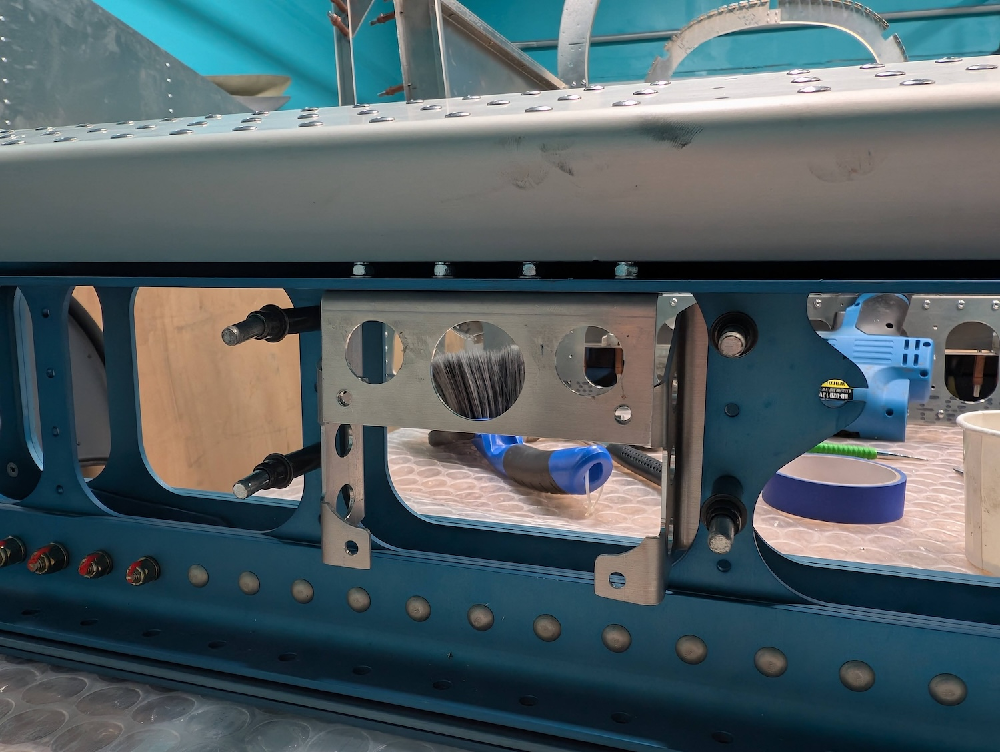

The brackets for the _Garmin_ aileron autopilot servo, which came with the kit, were installed on the center fuselage rear spar. Aligning the nut and bolt to mount the angle bracket was a pain, so a center punch and needle nose pliers were used to line them up. The photos follow the build sequence.

## Photos

_Brackets laid out against the rear spar. These are for some later assembly of the center fuselage._

_Same brackets, riveted._

_Washers on the bolts through the top flange of the spar, with a center punch used to line up the holes._

_Needle nose pliers holding a nut in place under the top flange._

## Aileron Servo Bracket

_Aligning the angle bracket against the spar with the center punch through the holes._

_Aileron servo bracket in place, fastened at the top flange._

_Another view of the installed bracket, the other ones are only Clecoed, to be riveted later._
