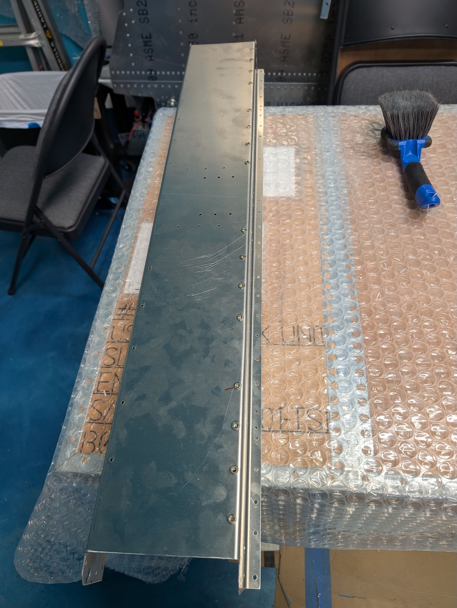
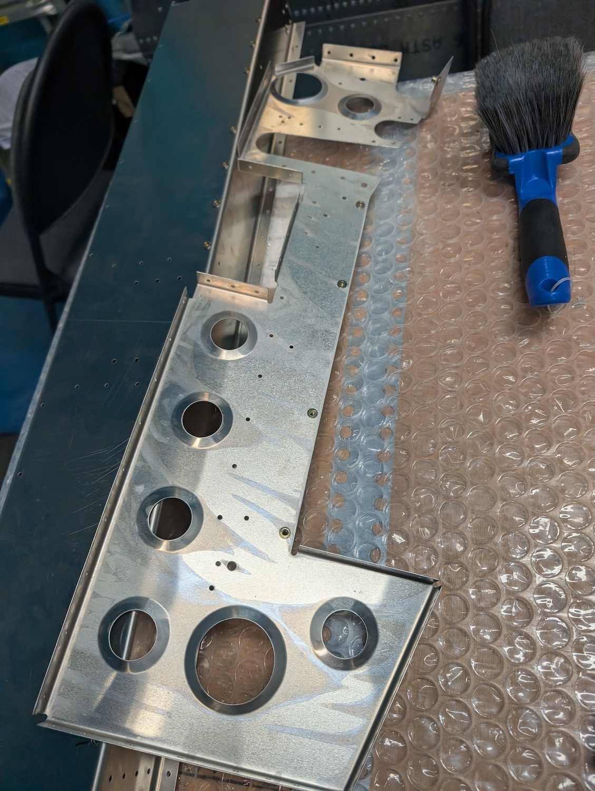
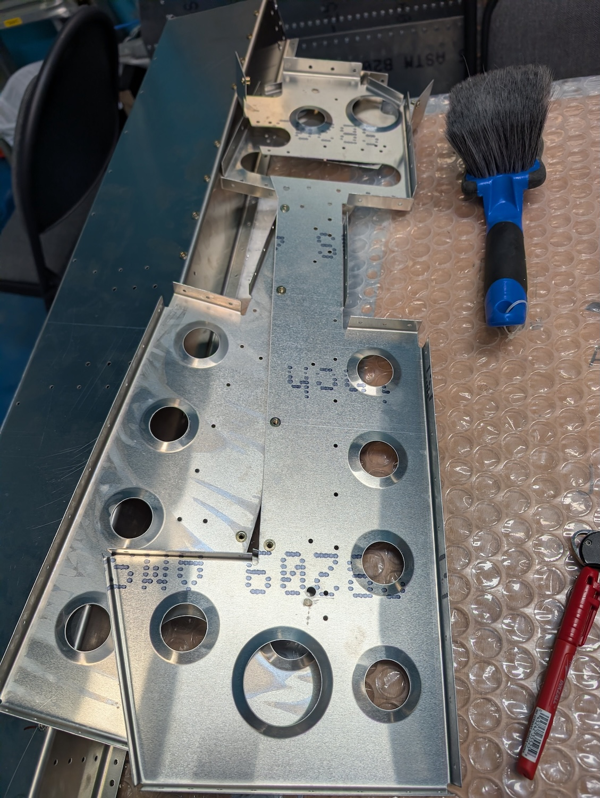
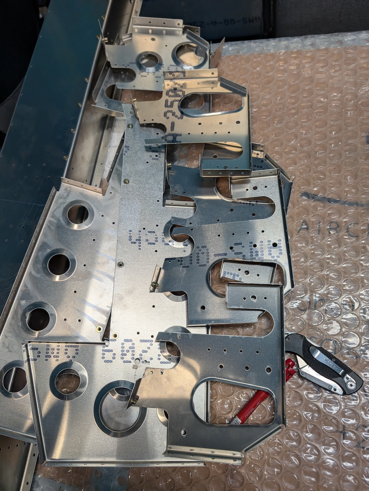
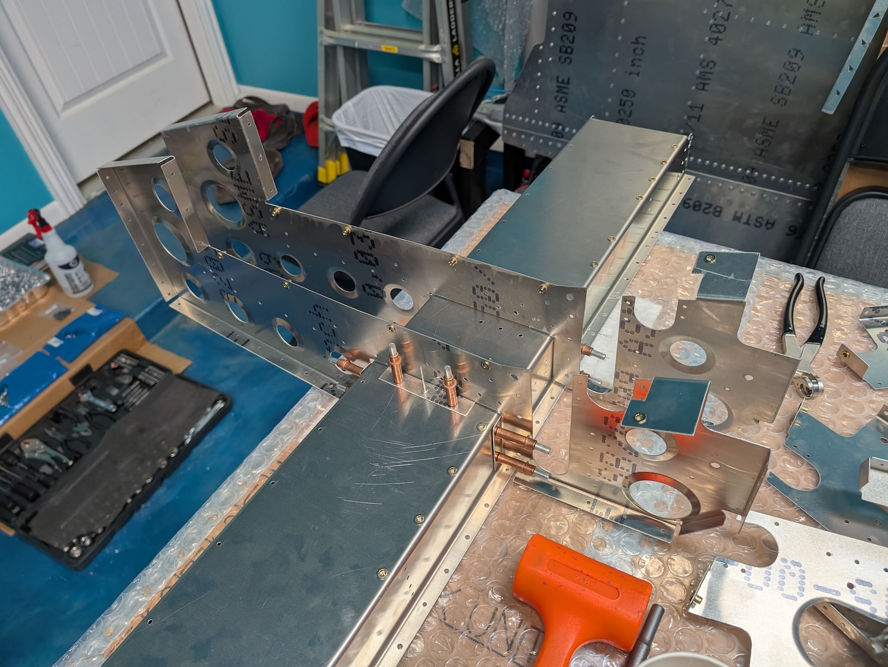
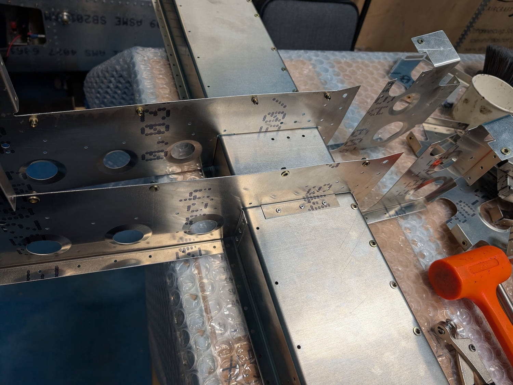
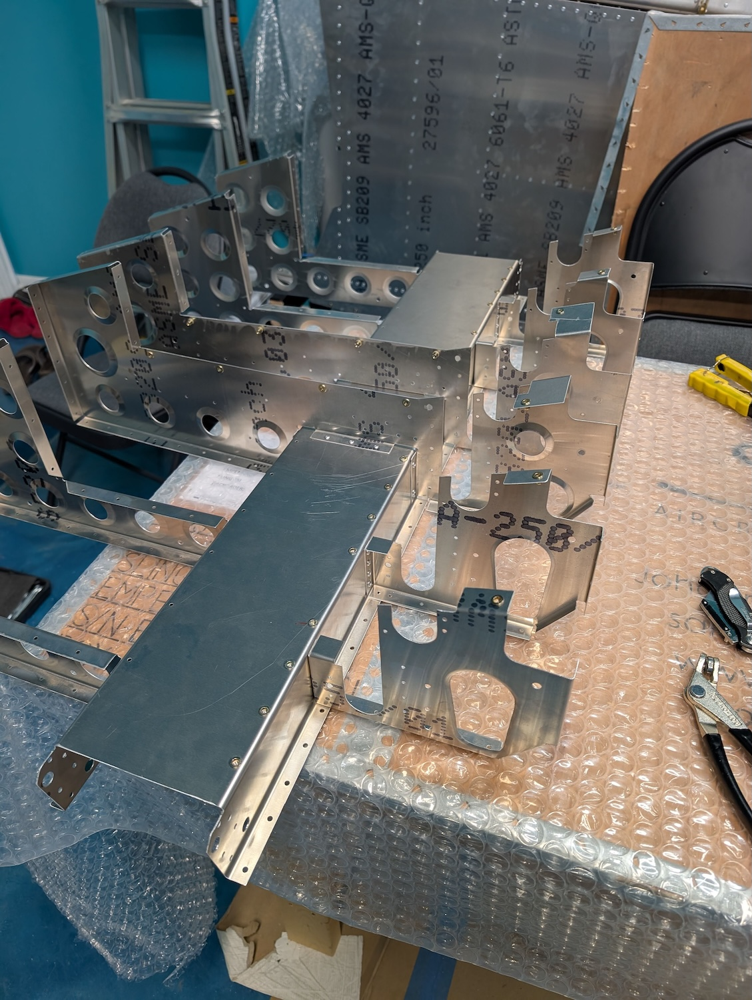
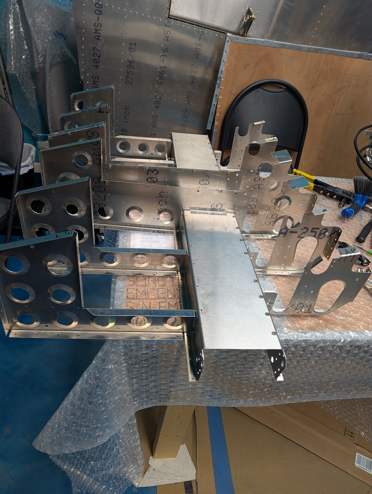
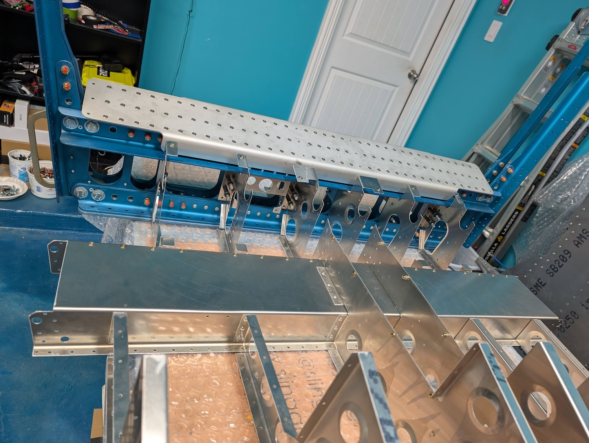
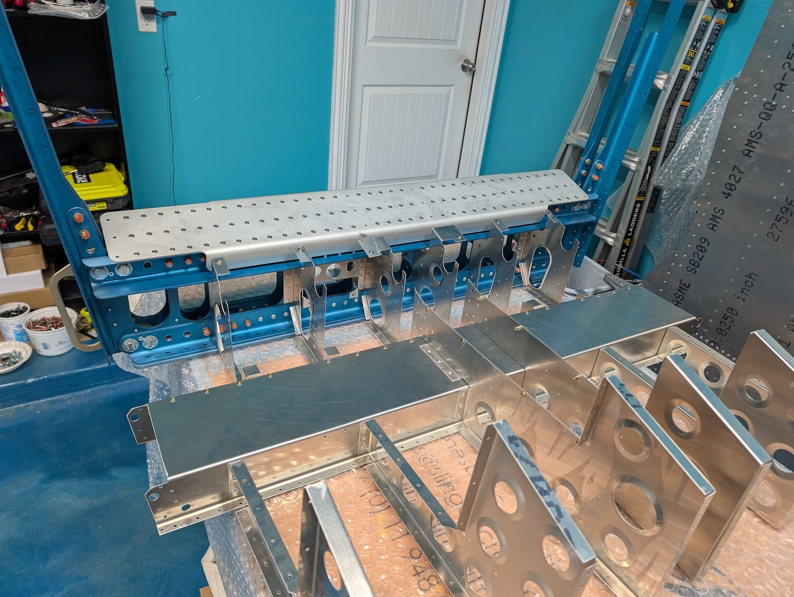

The landing gear channel and the center fuselage floor ribs were assembled. The channel runs parallel to the center wing carrythrough (the blue assembly, which comes pre-assembled from the factory) and perpendicular to the ribs. Rivnuts were set in the channel with a new tool, and the ribs were temporarily assembled with `3.2mm` copper clecos before riveting. The assembly was straightforward, but the center 2 ribs needed some light taps from a dead blow hammer to fit onto the landing gear channel. The photos follow the build sequence.

## Rivnuts and Landing Gear Channel

_Landing gear channel with rivnuts installed along the flange and web._

_Rib parts laid out against the landing gear channel, with rivnuts installed._

_More of the floor rib parts laid out. The ribs came bent this way from the factory. Rivnuts were installed._

_All the floor rib parts laid out, with rivnuts installed where appropriate._

## Clecoing and Riveting

_First ribs held to the landing gear channel with copper clecos._

_Ribs fitted over the channel, some riveted and the rest still clecoed. A dead blow hammer was used to tap the center ribs into place._

_More ribs riveted, the remaining ones still clecoed to be riveted later._

## Assembled Ribs

_Floor ribs and landing gear channel assembled._

_Assembly set in front of the center wing carrythrough._

_Another view of the assembly next to the center wing carrythrough._

## Tools
* Rivnut tool for installing the rivnuts: [https://www.amazon.com/dp/B08NDFZV6Z](https://www.amazon.com/dp/B08NDFZV6Z)
